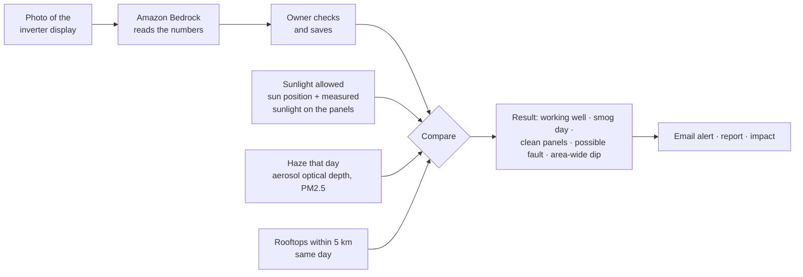
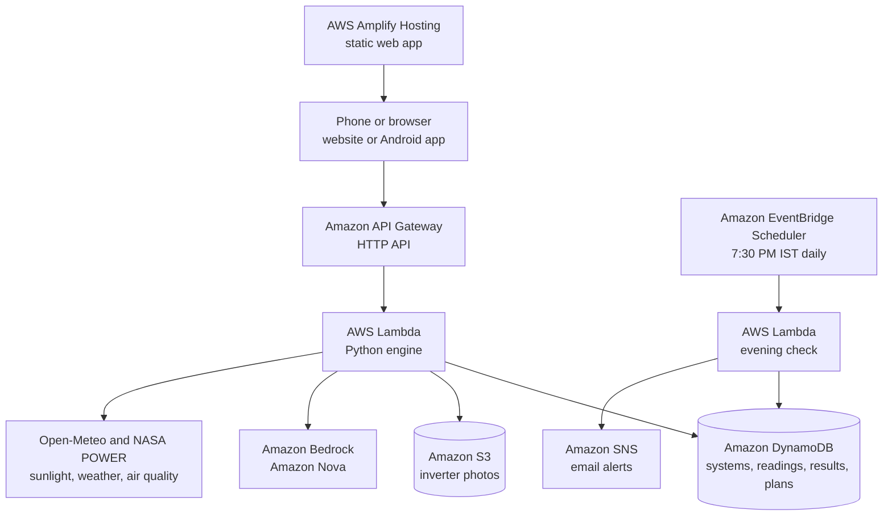

# SuryaWatch

**Plan rooftop solar. Then make sure it delivers.**

SuryaWatch is a free web application (and Android application) for Indian homes with rooftop solar, or thinking about it.

- **Plan** sizes a rooftop system from a roof drawn on a satellite map and one electricity bill. It works out the real cost after the PM Surya Ghar and Delhi subsidies, the monthly benefit and the payback time.
- **Watch** reads a phone photo of the inverter display with AI. Every day it tells the owner whether low output was **smog** (nothing to fix), **dust** (clean the panels, and what it costs per week) or a **fault** (call the installer).

There is no extra hardware: just a phone camera and the inverter every solar system already has. The app works in **English and Hindi**.

Built for **Environmental Hacks 2026** (WeMakeDevs × AWS), **Track 03: Waste and Energy**. It runs entirely on AWS: Lambda, API Gateway, DynamoDB, S3, Bedrock, SNS, EventBridge Scheduler and Amplify.

**Live Demo:** [Open SuryaWatch](https://main.d2g6wkf6szeo52.amplifyapp.com)

**Prototype Video:** [Watch the Demo](LINK)

## The problem

- **Solar is booming, but no one monitors it.** Under PM Surya Ghar scheme,over 50 lakh home rooftop solar systems have been subsidised across India, with a target of 75 lakh by December 2026. Once installed, almost no owner checks whether the panels make what they should.

- **Low output has three causes that look identical on the inverter:** smog or haze (nothing to fix), dust (clean the panels) or a fault (call the installer).
  - Owners guess. They wash panels on smoggy days, wasting water, or miss a real fault for weeks.
  - Air pollution and dust can cut solar output in India by 17–25% (Duke University and IIT Gandhinagar). Delhi's winter smog is the worst case.
- **Before buying, families are stuck.** They don't know the right size, the cost after subsidies, or how fast it pays back.

## What SuryaWatch does

| Part | For | What it gives you |
|---|---|---|
| **Plan** | A home without solar | Draw the roof on a satellite map, enter monthly units (or read them from a bill photo). Get the system size in whole 550 W panels, cost after subsidies, monthly benefit, payback, 25-year benefit and CO₂ avoided. |
| **Watch** | A home with solar | Photograph the inverter. AI reads it. SuryaWatch compares what you made with what that day's sunlight allowed, takes out the haze, and says: working well, smog day, clean panels, possible fault, or area-wide dip. |
| **Installer report** | Owner and installer | A printable two-page A4 report for any period: performance, promised vs actual units, fault messages, cleanings and clear requests for the installer. Shareable as a link. |
| **Impact** | Everyone | Live public totals: rooftops watched, units made, CO₂ avoided, smog days explained, faults caught, roofs planned. Totals only, never personal data. |

## Features

**Plan**

- **Find your roof using a satellite map.** Search by address, use your current location or draw your roof on the map to calculate its area automatically.
- **Read your electricity bill with AI.** Upload a Photo, and Amazon Bedrock identifies the monthly units, electricity provider (DISCOM), and sanctioned load in your bill. Your bill's photo is not stored, and your name, address, account number, and other personal details are not scanned.
- Real subsidy rules:
  - PM Surya Ghar central subsidy.
  - Delhi Solar Policy 2024 capital subsidy and generation incentive.
  - DERC slab tariff and Delhi's free 200 units.
  - Net metering.
- **Compare your estimated monthly Solar generation with your electricity usage.** You can also look at the assumptions behind your calculations and the nine-step process to apply for PM Surya Ghar.
- **Share your solar plan on WhatsApp** or select **We installed this** to begin tracking your rooftop. SuryaWatch then uses the plan's estimated yearly generation as a target to compare with your system's performance to monitor its production.

**Watch**
- **Photo reading** of two-line LCD inverter displays: power now, E-Today, E-Total and the status message. The photo's own clock (EXIF) tells the reading's time. The owner looks at the numbers before saving.
- **Daily result.**
  - **Performance** and **generation shortfall** always add up to 100%. The shortfall is split between the part haze explains and the part your panels lost.
  - Rupees lost per week, and that day's air quality.
- **Neighbourhood check.** If most of the SuryaWatch rooftops in a 5 km radius fell on the same day, the cause was the sky, not your panels: no cleaning alert is sent. If the others did fine and you didn't, the problem is on your roof.
- **Next two days:** likely units and clear, hazy, heavy-smog, cloudy or rain advice. Rain of 5 mm or more is a free wash.
- **Dust and the best day to clean.**
  - Learns your roof's dust build-up rate from its own readings after each wash.
  - Picks the cleaning interval that keeps "dust loss + cleaning cost" lowest.
  - Says "wait for the rain" when rain is forecast.
- **Promised vs got:** actual units against the installer's promise or the plan, using the inverter's lifetime counter, so missed days still count.
- **Cleaning effect** (before vs after a cleaning) and a green **day-by-day calendar**.
- **Evening email alerts** at 7:30 PM IST: dust (with the best day to clean), faults, smog days, no reading yet, and warnings for heavy smog or rain tomorrow.
- **Ask SuryaWatch:** a helper on Amazon Bedrock that answers questions in English or Hindi using the user's own numbers and checked scheme facts.

**Everywhere**
- **English | हिंदी** switch for the whole app, including results, forecasts, reports and WhatsApp text.
- Phone-first layout, light theme, readable serif type.
- An **Android app** from a single self-contained HTML file. It asks for the server address on first launch.

## How a daily check works



**The engine, in brief**

| Step | How |
|---|---|
| Sunlight allowed | Sun position (NOAA equations) and Open-Meteo's measured sunlight on the panel's own tilt and direction (global tilted irradiance), times system size and a performance ratio of 0.85, with a −0.35%/°C temperature correction. |
| Haze | Estimated loss = 0.25 × (aerosol optical depth − 0.4), between 0% and 40%. |
| Numbers shown | Performance = made ÷ sunlight allowed. Generation shortfall = 100% − performance = haze share + panel share. |
| Healthy | 92% or more of what the hazy sky allowed. If haze cut 8% or more that day, it is a **smog day**. |
| Dust or check | Below 92%: **dust** if there was no cleaning or ≥ 2 mm of rain for 3+ days, otherwise **check system**. |
| Fault | The inverter shows an error code, or output falls below 60% of the roof's recent days on a non-cloudy day. |
| Area-wide dip | At least 2 rooftops within 5 km reported, and both this roof and their median are below 85%. |
| Final reading | After 6 PM, or once 97% of the day's expected energy has passed. |
| Dust rate | One shared slope across clean spells (each spell keeps its own starting level). Until there is enough data: 0.4%/day (IIT Bombay rooftop, dry season). |
| Best cleaning interval | T = √(2C / r), where C = cost of one cleaning and r = daily growth of the rupee loss. Kept between 3 and 30 days. |
| Planner | NASA POWER long-term monthly sunlight × tilt gain 1.08 × performance ratio 0.77. 10 m² of shade-free roof per kW, sized in whole 550 W panels. |

## Architecture



| AWS service | Role |
|---|---|
| AWS Lambda | The SuryaWatch engine (Python 3.12, arm64, standard library only) and the evening check |
| Amazon API Gateway | One HTTP API for the app |
| Amazon DynamoDB | Single table (pk/sk), on-demand capacity |
| Amazon S3 | Private bucket for inverter photos (bill photos are never stored) |
| Amazon Bedrock | Amazon Nova (`us.amazon.nova-2-lite-v1:0`, falling back to Nova Lite and Nova Pro) reads displays and bills and answers questions |
| Amazon EventBridge Scheduler | Runs the evening check at 7:30 PM Asia/Kolkata |
| Amazon SNS | Email alerts, filtered per system |
| AWS Amplify Hosting | Serves the web app |
| AWS SAM | Infrastructure as code (`template.yaml`), one-command deploy |

## Run it locally (no AWS needed)

You need Python 3.9 or newer (use `python3` instead of `python` on macOS and Linux). There is nothing to install: the backend uses only the standard library.

```bash
git clone https://github.com/aryanniralacsda25a07014-design/Suryawatch.git
cd Suryawatch
python scripts/local_server.py --mock-ai
```

Open **http://localhost:8080**.

- `--mock-ai` gives test values for photo and bill reading and a test answer from the helper, because the real AI runs on Amazon Bedrock.
- `--offline` adds made-up weather, so no internet is needed.
- To fill the app with clearly labelled sample data (a sample rooftop and three sample neighbours), run this in a second terminal:

  ```bash
  python scripts/sample_data.py
  ```

## Deploy to AWS

You need:

- an AWS account,
- **Amazon Bedrock model access to Amazon Nova** in `us-east-1`,
- **AWS CloudShell**, which has the SAM CLI, Python and git preinstalled.

```bash
git clone https://github.com/aryanniralacsda25a07014-design/Suryawatch.git
cd Suryawatch
bash scripts/deploy.sh
```

`deploy.sh` does four things:

1. Runs the tests.
2. Deploys the stack with `sam deploy` (stack `suryawatch`, region `us-east-1`).
3. Writes the API address into the web app and publishes it to Amplify Hosting.
4. Prints the **ApiUrl** and the **WebUrl**.

Email alert subscribers get one AWS confirmation email first. A step-by-step guide is in [`docs/SuryaWatch_AWS_Guide_for_Agrim.pdf`](docs/SuryaWatch_AWS_Guide_for_Agrim.pdf).

To remove everything later:

```bash
sam delete --stack-name suryawatch --region us-east-1
```

## Android app

```bash
python scripts/build_single_html.py                                   # asks for the server address on first launch
python scripts/build_single_html.py --api <ApiUrl> --web <WebUrl>     # or build the addresses in
```

This writes one self-contained file, `dist/SuryaWatch.html`, which any HTML-to-APK converter can wrap. In the converter, allow:

- internet,
- file upload and camera,
- location,
- opening links in the browser (WhatsApp sharing, and printing the installer report).

## API

All routes are served by one Lambda behind API Gateway and return JSON.

| Method | Path | Purpose |
|---|---|---|
| GET | `/health` | Status and the public web address |
| POST | `/plan` | Rooftop solar plan (size, cost, subsidies, payback) |
| POST | `/bill` | Read a bill photo (never stored) |
| GET | `/expected` | Expected output curve for a location and day |
| POST | `/systems` | Register a rooftop |
| GET | `/systems/{id}` | Rooftop summary: history, promise, cleaning effect |
| GET | `/systems/{id}/day?date=&lang=` | The day's result, chart data and neighbourhood check |
| POST | `/systems/{id}/photo` | Read an inverter photo |
| POST | `/systems/{id}/readings` | Save readings |
| POST | `/systems/{id}/readings/delete` | Remove a reading |
| POST | `/systems/{id}/events` | Log a cleaning or a note |
| GET | `/systems/{id}/outlook` | Next two days |
| GET | `/systems/{id}/dust` | Dust rate and the best day to clean |
| POST | `/systems/{id}/settings` | Cleaning cost and the value of a unit |
| GET | `/systems/{id}/report?from=&to=` | Installer report |
| POST | `/systems/{id}/alerts` | Subscribe an email |
| POST | `/systems/{id}/alerts/test` | Run today's check now |
| POST | `/ask` | Ask SuryaWatch (English or Hindi) |
| GET | `/impact` | Public totals |

## Project structure

```
backend/        Lambda code (standard library Python)
  api.py          router for every route above
  solar.py        sun position, clear sky, expected output
  weather.py      Open-Meteo sunlight, air quality, rain; NASA POWER
  planner.py      sizing, tariffs and subsidies
  verdict.py      the day's result
  watch.py        rooftops, readings, day view, outlook, promise
  dust.py         dust rate and best cleaning day
  neighbours.py   neighbourhood check
  report.py       installer report
  impact.py       public totals
  reader.py       Bedrock: inverter displays and bills
  assistant.py    Bedrock: Ask SuryaWatch
  alerts.py       SNS email alerts
  daily_check.py  the 7:30 PM evening check
  i18n.py         English and Hindi messages
  store.py        DynamoDB and S3 (local JSON files when testing)
frontend/       static web app (HTML, CSS, JavaScript, no build step), i18n.js has the Hindi text
scripts/        local_server.py, sample_data.py, import_csv.py, build_single_html.py, deploy.sh
tests/          unit and API tests
docs/           user guide and AWS guide (PDF), README images
template.yaml   AWS SAM template
```

## Tests

```bash
python -m unittest discover -s tests
```

103 tests cover:

- the solar engine and planner, including the subsidy maths,
- the daily results and Hindi messages,
- photo and bill parsing,
- the promise, outlook, dust, neighbourhood, report and impact features,
- the evening email check.

## Data sources and assumptions

| Source | Used for |
|---|---|
| [Open-Meteo](https://open-meteo.com) forecast and air-quality APIs | Measured and forecast sunlight on tilted panels, cloud, temperature, rain, PM2.5, AQI, aerosol optical depth |
| [NASA POWER](https://power.larc.nasa.gov) | Long-term monthly sunlight for planning |
| PM Surya Ghar (PIB, March 2025) | ₹30,000/kW for the first 2 kW and ₹18,000 for the 3rd kW, capped at ₹78,000 |
| Delhi Solar Policy 2024 | ₹2,000/kW capital subsidy (up to ₹10,000). Generation incentive of ₹3/unit (up to 3 kW) or ₹2/unit (3–10 kW) for 5 years |
| DERC tariff and the Delhi power subsidy | Energy slabs; up to 200 units a month free, 50% off (up to ₹800) for 201–400 |
| CEA CO₂ baseline database (FY 2023-24) | 0.727 kg CO₂ per unit |
| pv magazine India (IIT Bombay rooftop, 2021) | Starting dust rate of 0.4% per day |

All figures are estimates to help owners decide and check. Get vendor quotes before buying, and an installer's visit before any repair.

## Privacy

- Bill photos are read in memory and never stored. Names, addresses and account numbers are not read.
- A rooftop is reached only through its own link or ID.
- The neighbourhood check and the Impact page only show counts, totals and medians of at least two rooftops: never a name, place or one roof's figure.
- Sample data is always labelled "demo data" and kept out of public totals.

## Documentation

- [`docs/SuryaWatch_Complete_Guide.pdf`](docs/SuryaWatch_Complete_Guide.pdf): what SuryaWatch is, how it works and how to use every screen, with screenshots.


## Credits

[Leaflet](https://leafletjs.com) (BSD-2-Clause, in `frontend/vendor/leaflet`) · satellite imagery © Esri, Maxar, Earthstar Geographics · address search by [OpenStreetMap Nominatim](https://nominatim.openstreetmap.org) · weather and air-quality data by [Open-Meteo](https://open-meteo.com) (CC BY 4.0) · sunlight climatology by [NASA POWER](https://power.larc.nasa.gov) · fonts: Source Serif 4 and Noto Serif Devanagari (Google Fonts).
